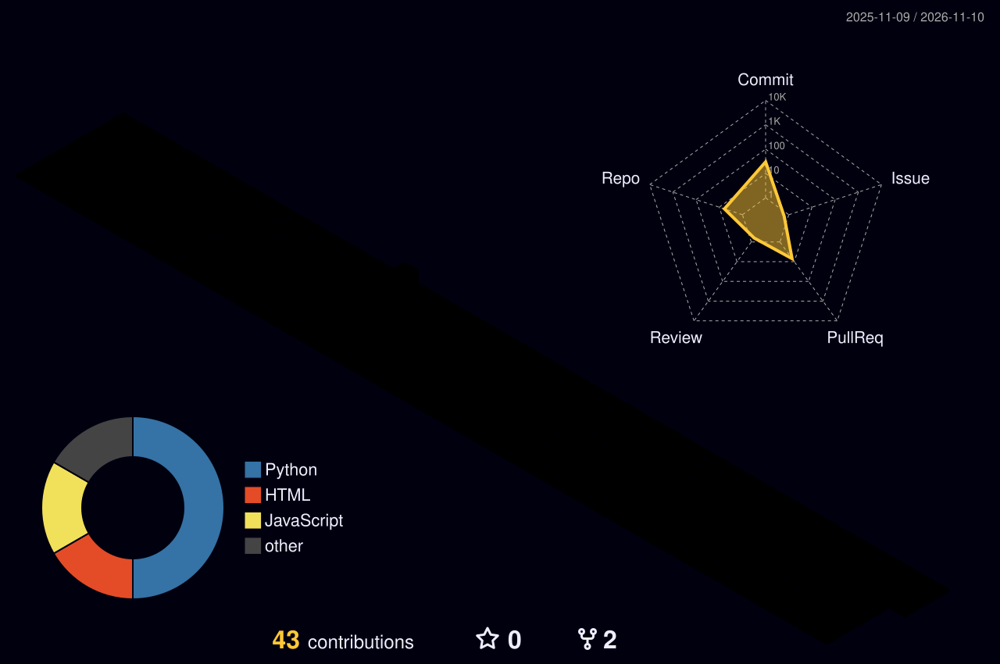

<p align="center">
  
</p>

<p align="center">
  
</p>

<p align="center">
  <a href="https://www.linkedin.com/in/hireshyadav2007/"></a>
  <a href="https://hiresh2007.github.io/security-engineering-portfolio/"></a>
  <a href="https://github.com/Hiresh2007/Cybersecurity-Journey"></a>
</p>

<p align="center">
  
</p>

### About me

First-year Computer Science student working toward a **SOC Analyst / Security Analyst** internship by summer 2027.
I learn by building: traffic analysis tools, detection logic and the tests that prove they work.

- 🔭 **Building:** [`pcap-triage`](https://github.com/Hiresh2007/pcap-triage), offline packet-capture triage with explainable detections
- 🛡️ **Focus:** network traffic analysis · intrusion detection · SOC workflows · Linux
- 📚 **Studying:** TryHackMe Pre Security → SEC1 · HTB Academy (CJCA) · Cisco NetAcad · CompTIA Security+
- 🎯 **Next:** detection rules for [SigmaHQ/sigma](https://github.com/SigmaHQ/sigma)

### Featured project

<table>
<tr>
<td width="55%" valign="top">

#### [pcap-triage](https://github.com/Hiresh2007/pcap-triage)

Reads a `.pcap`/`.pcapng`, summarises flows and talkers, and flags
TCP port scans and subnet sweeps, mapped to MITRE ATT&CK **T1046**.
Every finding carries its evidence, so it can be verified in Wireshark.

`Python` `Scapy` `pytest` `GitHub Actions`

</td>
<td width="45%" valign="top">

```text
$ pcap-triage analyze demo_scan.pcap
Findings (2)
 [MEDIUM] TCP vertical port scan [T1046]
   192.0.2.66 -> 102 ports in 0.5s
   open ports: 22, 80, 443
 [MEDIUM] TCP horizontal sweep on 445
   192.0.2.66 -> 30 hosts in 0.6s
```

</td>
</tr>
</table>

### Toolbox

<p>
  <b>Using</b><br/><br/>
  
</p>
<p>
  <b>Learning next</b><br/><br/>
  
  
  
  
  
</p>

### Contribution city

<p align="center">
  <picture>
    <source media="(prefers-color-scheme: dark)" srcset="https://raw.githubusercontent.com/Hiresh2007/Hiresh2007/output/profile-3d-contrib/profile-night-rainbow.svg"/>
    <source media="(prefers-color-scheme: light)" srcset="https://raw.githubusercontent.com/Hiresh2007/Hiresh2007/output/profile-3d-contrib/profile-season-animate.svg"/>
    
  </picture>
</p>

<p align="center">
  <picture>
    <source media="(prefers-color-scheme: dark)" srcset="https://raw.githubusercontent.com/Hiresh2007/Hiresh2007/output/github-snake-dark.svg"/>
    <source media="(prefers-color-scheme: light)" srcset="https://raw.githubusercontent.com/Hiresh2007/Hiresh2007/output/github-snake.svg"/>
    
  </picture>
</p>

<p align="center">
  
</p>
